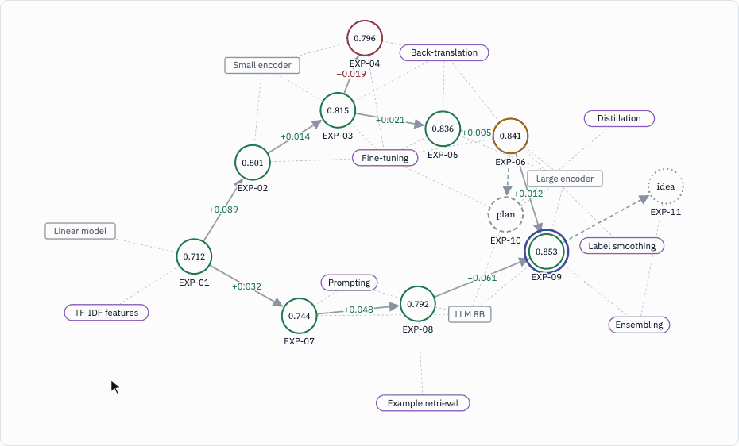
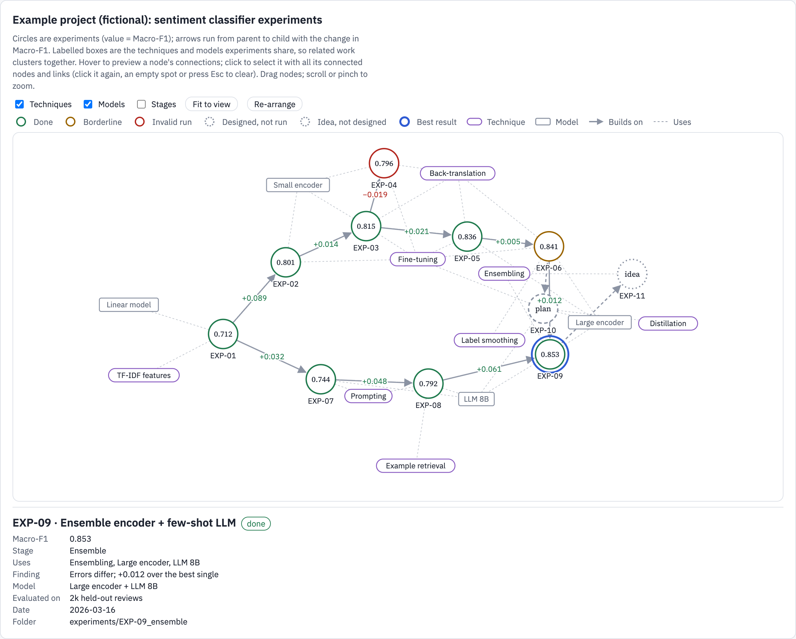
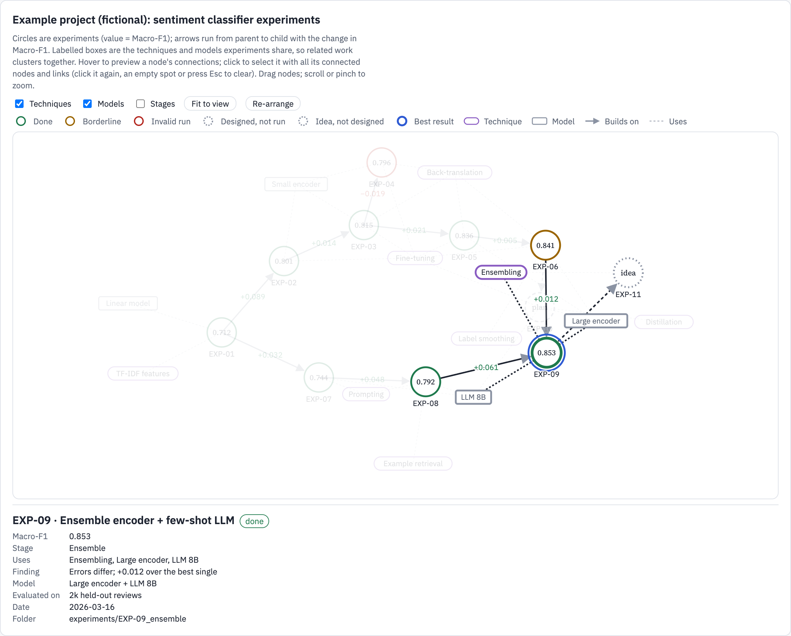
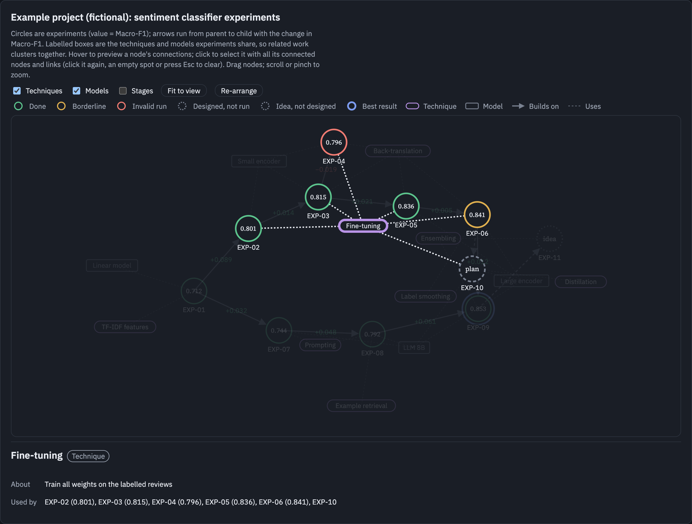
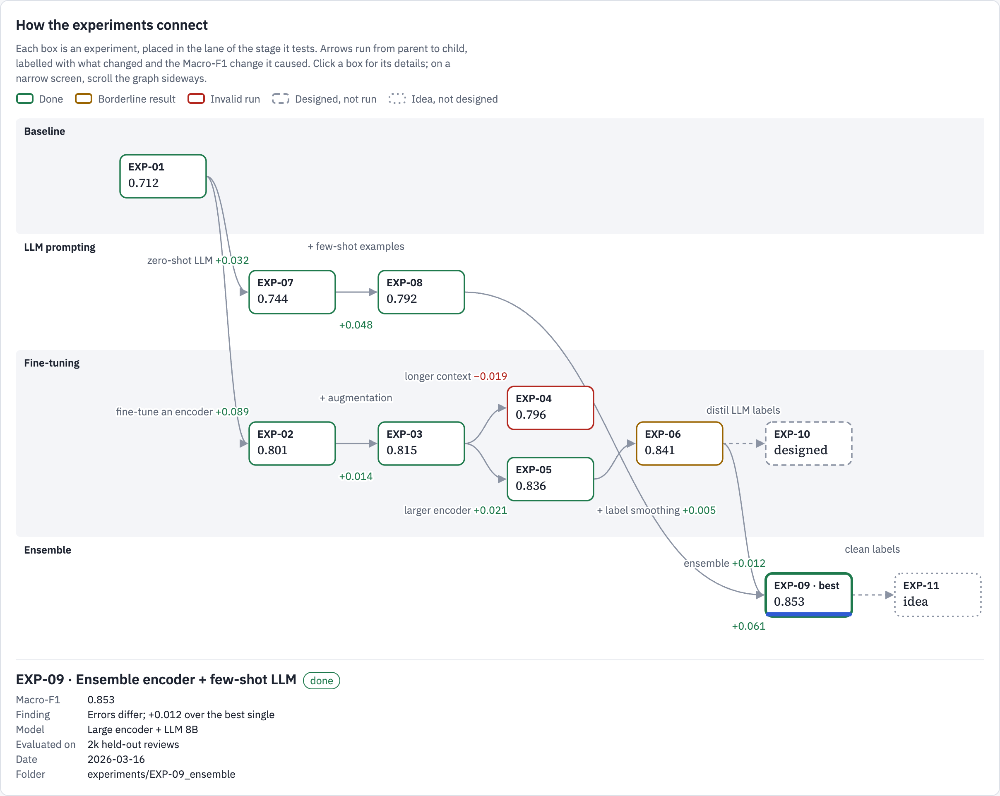

# Experiment lineage graph

A Claude Code plugin with one skill. It turns a project's experiments into an interactive graph you can read at a glance:

- **Experiments are circles** showing their metric (for example MAP@3 or accuracy). The border shows status: done, borderline, invalid, designed-not-run, or just an idea. An accent ring marks the best valid result.
- **Shared techniques and models are nodes** linked to every experiment that uses them, so related work clusters together.
- **"Builds on" arrows** run from parent to child with the metric change each step caused, green if better, red if worse.
- **Click a node** to select it together with all its connected nodes and links. Everything else fades and a details panel opens. Hover previews another node's connections. Click again, click an empty spot or press Esc to clear.
- Drag nodes, zoom and pan, fit to view, re-arrange, and toggle techniques, models and pipeline stages.

A second layout draws the same data left to right in one lane per pipeline stage, for strict timelines.

**[Try the live demo](https://dreamrunnermoshi.github.io/experiment-lineage-graph/)** ([lane layout](https://dreamrunnermoshi.github.io/experiment-lineage-graph/examples/demo-lanes.html)).





Click a node to select it with everything it connects to. Here the best result, EXP-09, is selected: the parents it builds on, the ensembling technique and the two models it combines stay in focus.



Techniques work the same way: selecting "Fine-tuning" shows every experiment that uses it and their scores. The page follows the viewer's light or dark theme.



The lane layout puts each pipeline stage in its own lane; siblings stack, and every arrow says what changed and by how much.



The example data in the screenshots is fictional.

The [live demo](https://dreamrunnermoshi.github.io/experiment-lineage-graph/) is [`examples/demo.html`](examples/demo.html) served by GitHub Pages; open it or [`examples/demo-lanes.html`](examples/demo-lanes.html) locally to try it offline. They load d3 from cdnjs and fonts from Google Fonts.

## Install

```
claude plugin marketplace add DreamRunnerMoshi/experiment-lineage-graph
claude plugin install experiment-lineage-graph@dreamrunnermoshi
```

Or from inside a Claude Code session: `/plugin marketplace add DreamRunnerMoshi/experiment-lineage-graph`, then `/plugin install experiment-lineage-graph@dreamrunnermoshi`.

To get updates later: `claude plugin update experiment-lineage-graph@dreamrunnermoshi`.

## Use

Ask Claude in your project, for example:

- "Show our experiments as a graph."
- "Build a dashboard of the experiment history with a network graph of what each run builds on."

The skill reads the experiment records in your repository (an index, experiment docs, run summaries), builds four small tables and draws the graph. It never invents scores; proposals that are not designed yet are drawn as "idea" nodes.

| Table | Columns |
|---|---|
| nodes | `id, stage, title, status, <metric>` and optionally `finding, model, eval_set, date, folder` |
| edges | `from, to, change` (parent to child, with the one change made) |
| entities | `id, type, label, description` (techniques and models) |
| uses | `experiment, entity` (what each experiment uses) |

`status` is one of `done`, `borderline`, `invalid`, `planned`, `idea`.

## Where it runs

- **With the claude.ai Artifact tool** (Claude Code sessions connected to claude.ai): the skill publishes the graph as a private artifact on the Dashboard artifact type, with the data attached as tables. You choose whether to share it.
- **Anywhere else:** the skill builds one self-contained HTML page (the plain-artifact route in `SKILL.md`), the same way `examples/demo.html` is built.

## Files

```
.claude-plugin/plugin.json, marketplace.json
skills/experiment-lineage-graph/
  SKILL.md                      instructions Claude follows
  template/network-graph.html   network layout (edit only its CFG block)
  template/lineage-graph.html   lane layout
  template/standalone-shim.js   stand-in for the Dashboard data API in a plain page
  template/standalone-tokens.css colours, type and spacing, light and dark
  template/test.cjs             headless check of either layout on your CSVs
  template/example-*.csv        example data
examples/demo.html              the network layout on the example data
examples/demo-lanes.html        the lane layout on the example data
examples/build_demos.py         rebuilds both demos from the templates
```

To check a layout on your own data without a browser (needs Node.js):

```
npm i jsdom@24.1.3 d3@7.9.0
node skills/experiment-lineage-graph/template/test.cjs network nodes.csv edges.csv entities.csv uses.csv score
```

## Releasing a change

Edit the templates, run `python3 examples/build_demos.py`, bump `version` in `.claude-plugin/plugin.json`, commit and push.
Users then run `claude plugin update experiment-lineage-graph@dreamrunnermoshi`.

## Licence

MIT
